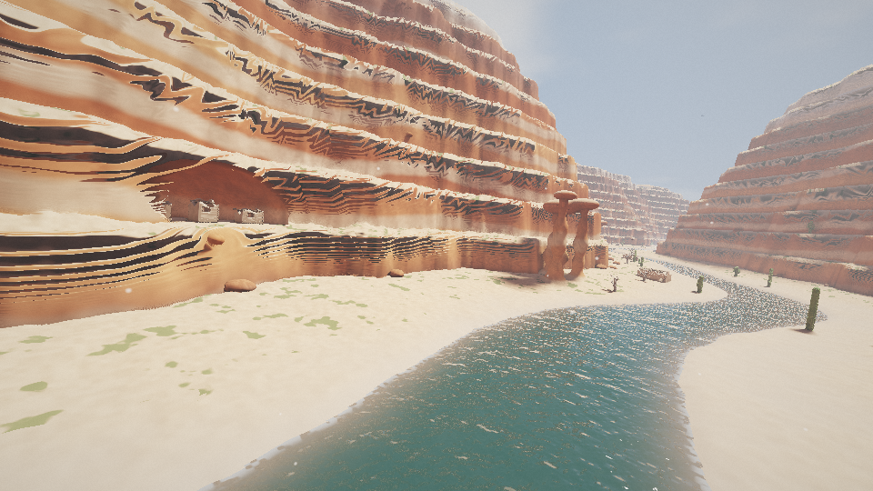
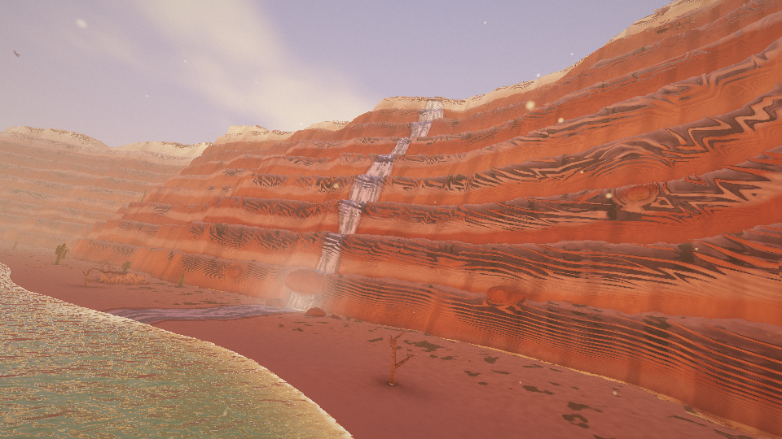
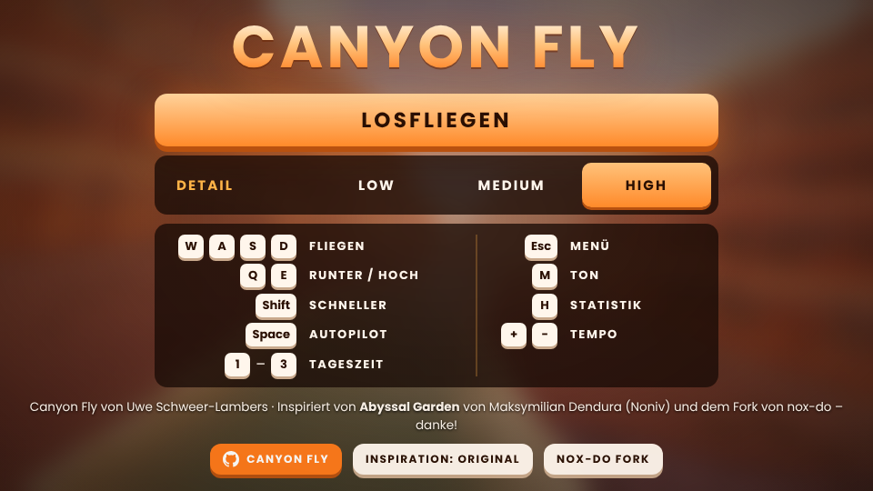

# Canyon Fly

**Flieg durch eine rote Sandsteinschlucht – direkt im Browser.**
*Fly through a red sandstone canyon, right in your browser.*

Terrassierte Felswände mit Gesteinsschichten, ein Fluss am Talgrund, Wasserfälle, Höhlen und Überhänge, Felsnischen mit verlassenen Lehmhäusern, Saguaro-Kakteen, verdorrte Bäume, Hoodoos, kreisende Geier und ein Schwalbenschwarm. Alles wird per Code erzeugt: keine Bilder, keine 3D-Modelle, keine Sounddateien. Die ganze Welt steckt in **einer einzigen HTML-Datei** (`index.html`).

## Spielen

**[▶ Canyon Fly im Browser starten](https://uschweerlambers-art.github.io/Canyon-Fly/)** – Desktop-Chrome oder -Edge mit WebGPU.

Offline: [`index.html`](index.html) herunterladen und in Chrome oder Edge öffnen. Nichts zu installieren.

## Steuerung

| | |
|---|---|
| Fliegen | `W` `A` `S` `D` + Maus (Freiflug) |
| Runter / Hoch | `Q` / `E` |
| Schneller | `Shift` |
| Autopilot ↔ Freiflug | `Space` |
| Tempo des Autopiloten | `+` / `−` |
| Tageszeit (Morgen, Mittag, Abendrot) | `1` – `3` |
| Menü (Pause, Detailstufe) | `Esc` oder `≡` |
| Ton an / aus | `M` |
| Statistik (fps, GPU-Zeit) | `H` |

Im Autopilot folgt die Kamera der Schlucht; Maus ziehen schaut sich um. Im Menü wählst du **Low**, **Medium** oder **High** – die Auflösung passt sich zusätzlich automatisch an (Ziel 60 fps).

## Was drin steckt

- **Reines WebGPU**, keine Engine, kein three.js – ein Fullscreen-Raymarcher in WGSL
- Gelände als Höhenfeld mit Terrassen, Erosionsrinnen und Schichtfarben; Höhlen und Überhänge als 3D-Distanzfunktionen darüber
- Objekte (Häuser, Kakteen, Bäume, Felsen, Hoodoos, Wasserfälle) werden in 32-m-Abschnitten entlang der Schlucht deterministisch erzeugt und nachgeladen – die Schlucht ist endlos
- Weiche Schatten, Umgebungsverdeckung, Sonnenstrahlen, Wasser mit Spiegelung und Schaum, Gischt an den Wasserfällen
- Vögel als analytische Silhouetten: kreisende Geier mit gespreizten Schwungfedern, flatternde Schwalben
- Soundscape live per Web Audio: Wind, Fluss, Wasserfallrauschen, Rufe mit Canyon-Echo

## Danke & Inspiration

Canyon Fly ist inspiriert von **[Abyssal Garden](https://github.com/Noniv/abyssal-garden)** von **Maksymilian Dendura (Noniv)** – einer prozeduralen Unterwasserwelt in einer einzigen WebGPU-HTML-Datei – und dem **[Fork von nox-do](https://github.com/nox-do/abyssal-garden)**, der sie weiterentwickelt hat. Die Idee „eine ganze Welt in einer Datei, alles aus Code“ und der Aufbau des Startmenüs stammen von dort. Der Code von Canyon Fly ist eigenständig neu geschrieben.

Herzlichen Dank an beide! Wer Abyssal Garden mag: [den Original-Autor unterstützen](https://ko-fi.com/noniv).

## Lizenz

[MIT](LICENSE) · © 2026 Uwe Schweer-Lambers
